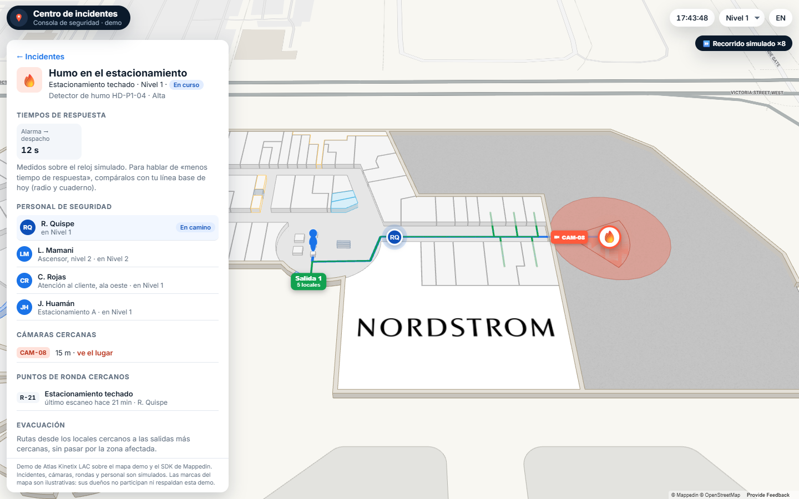
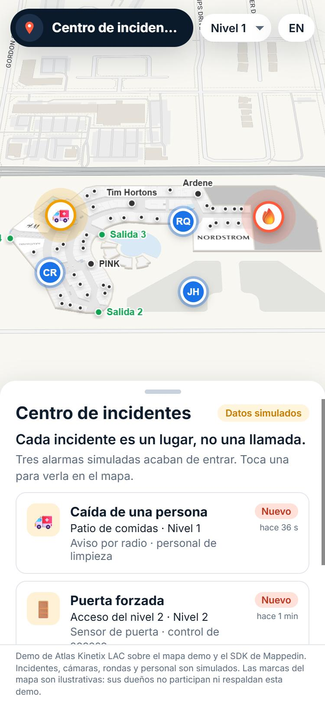
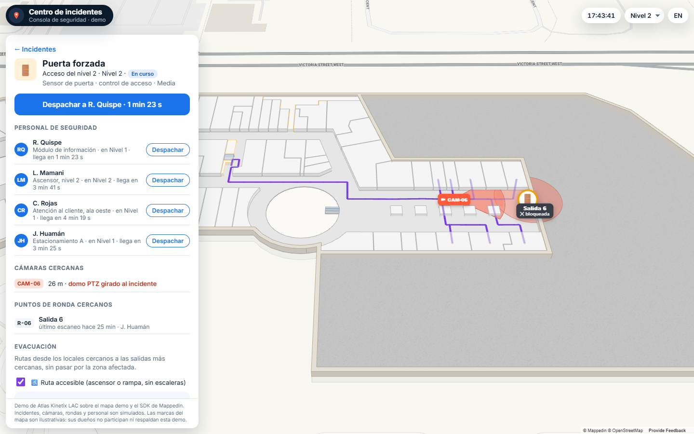
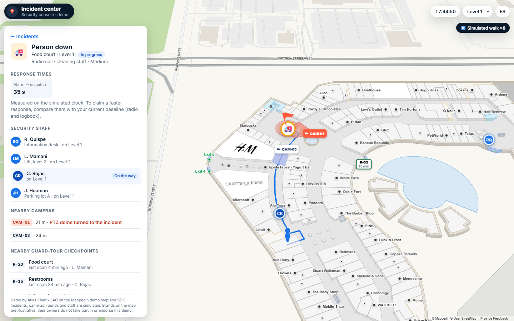

# Incident Center · Mappedin demo

**Every incident is a place, not a call.** A security console on an indoor map: a simulated alarm shows up as a pin at the exact spot, with the nearby cameras and their field of view, the guard-tour checkpoints and when they were last scanned, the nearest guard dispatched with their route and ETA, evacuation routes that avoid the affected area (with an accessible version), and an incident log with response times.

- Live (Spanish): https://incident-center-demo.atlas-lac.com/
- Live (English): https://incident-center-demo.atlas-lac.com/?lang=en
- Straight into a scenario: [`?incident=smoke&evac=1&dispatch=1`](https://incident-center-demo.atlas-lac.com/?incident=smoke&evac=1&dispatch=1) · [`?incident=door&evac=1&accessible=1`](https://incident-center-demo.atlas-lac.com/?incident=door&evac=1&accessible=1) · [`?incident=fall`](https://incident-center-demo.atlas-lac.com/?incident=fall)



## What it shows

1. **The incident is a pin, not a description.** Three simulated alarms come in: a person down by the food court (radio call), a forced door at the Level 2 entrance (access-control sensor) and smoke in the covered car park (smoke detector). Each one is a pin on the right floor, with its affected area drawn around it.
2. **Cameras and rounds around the pin.** The cameras within 40 m appear with their field of view; the ones that see the spot turn red, and if none does, the closest dome is turned to the incident (PTZ). The guard-tour checkpoints within 70 m show the minutes since their last scan and who scanned them; an overdue round (over 45 min) is flagged and goes to the log.
3. **Dispatch the nearest guard.** The ETA of every guard on duty is computed on the venue's own walking graph (1.5 m/s plus 25 s per floor change), not as a straight line. One tap dispatches the nearest one: their route is drawn, their dot walks it (simulated, ×8 so the demo does not wait) and the log records the radio acknowledgement and the arrival.
4. **Evacuation that avoids the affected area.** Routes from the stores around the incident to the closest exits, computed with the SDK's direction zones (`cost: Infinity`, `per-zone-entry`), so no route crosses the affected area and an exit inside it is marked blocked. The standard version excludes lifts; the accessible version uses the SDK's step-free routing (lifts and ramps, no stairs), with a note that lifts are only used in an evacuation with staff and if the building plan allows it.
5. **Incident log and response times.** Time-stamped actions and who took them (system, operator, guard), plus alarm → dispatch, dispatch → on scene and alarm → on scene. The note is explicit: to claim a faster response, compare with the site's current baseline (radio and logbook). The demo does not invent that baseline.

| Phone | Accessible evacuation from Level 2 |
|---|---|
|  |  |



## What is real and what is simulated

| Real (Mappedin demo venue and SDK) | Simulated, labelled as such in the app |
|---|---|
| The map, floors, stores, entrances, lifts and escalators | The three alarms and their sources |
| Walking routes, ETAs on the routing graph, direction zones, step-free routing | Cameras (placed every ~26 m along the corridors around each alarm, looking down the corridor) |
| Floor changes along a route | Guard-tour checkpoints and their last scan |
| | The four guards, their posts and their movement |

In production each layer would come from its own system: the VMS for cameras and live video, the guard-tour system for checkpoints, the staff app or radios for positions, the alarm panels and access control for incidents. The map is what ties them together.

## Map and data

- Mappedin's Enterprise demo venue **Mall** (`mappedin-demo-mall`, two levels) with the public demo key from the [Mappedin docs](https://developer.mappedin.com/docs/demo-keys-and-maps). Override with `VITE_MAPPEDIN_KEY`, `VITE_MAPPEDIN_SECRET`, `VITE_MAPPEDIN_MAP_ID` in `.env` (ignored by git).
- Brand names on the demo map are illustrative: their owners do not take part in or endorse this demo.
- Built by Atlas Kinetix LAC on Mappedin's public SDK and demo map. It is not a Mappedin product and does not reproduce Mappedin's own apps.

## Run

```bash
npm install
npm run dev        # http://localhost:5173
npm run build      # tsc strict + vite build
```

Deep links: `?incident=fall|door|smoke`, plus `&evac=1`, `&accessible=1`, `&dispatch=1`, and `?lang=en`. `&shot=1` skips camera animations for headless screenshots.

`npm run deploy` builds and publishes `dist/` to the `gh-pages` branch, which GitHub Pages serves on the custom domain (`public/CNAME`).

### Code map

- `src/scenario.ts`: builds the simulated operation on the venue: exits, alarms, checkpoints, guards and cameras.
- `src/main.ts`: the console: map layers, dispatch and walking, evacuation routes, panel, log and response times, phone bottom sheet.
- `src/geo.ts`: small geometry in metres (distance, bearing, camera wedge, circle).
- `src/i18n.ts`: Spanish (default) and English texts.
